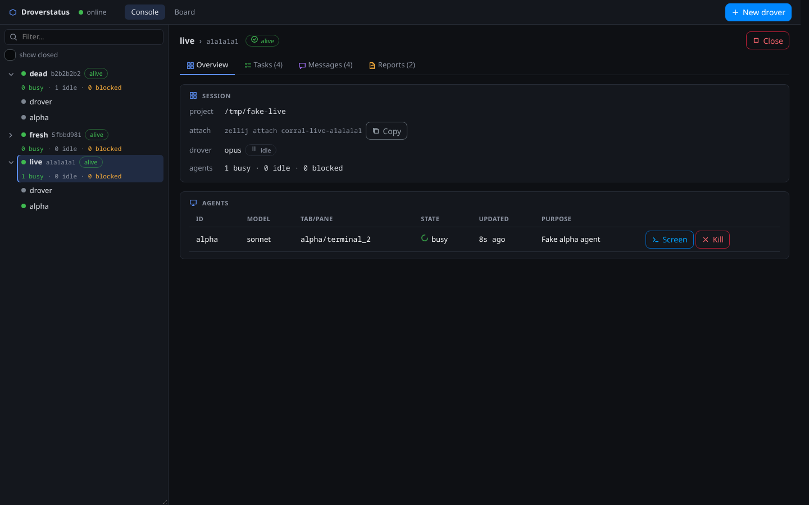
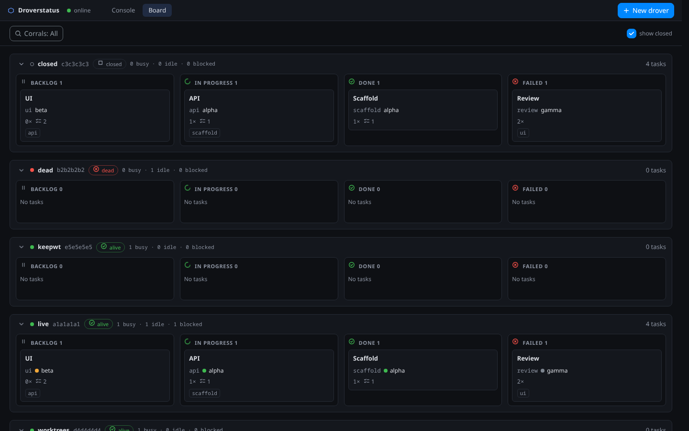

# droverstatus

Local web UI for drover (the `ferenyl-claude` plugin) corrals: live view of drovers, agents (busy/idle/blocked), tasks, messages and reports, plus create/close/revive corrals, kill agents, send messages and view agent screens. State is read from `~/.claude/drover/<HID>/`; all mutations go through `drover.sh`.

## Requirements
- Linux (tested); macOS untested
- Node >= 22 and npm
- [Zellij](https://zellij.dev)
- The drover plugin `ferenyl-claude` >= 0.9.0 (provides `drover.sh`)

## What this is not
No authentication, no multi-user support, not for remote access. It listens on loopback by default; see [SECURITY.md](SECURITY.md).

## Screenshots



## Install / run
```
npm install
npm run dev     # server (tsx watch) + vite dev server; ports: npm run dev -- -p 4187 -w 5187
npm start       # build web, then serve everything from the server
npm run build:dist   # single executable: dist/droverstatus (needs Node >= 22)
```
### Single file (dist)
`npm run build:dist` bundles server and UI into one executable, `dist/droverstatus` (needs Node >= 22 on the target machine).
```
./dist/droverstatus              # run directly, UI + API on http://127.0.0.1:4177
./dist/droverstatus -p 5000      # other port (--port 5000)
./dist/droverstatus --bind 192.168.1.5   # non-loopback, no auth: trusted networks only
cp dist/droverstatus ~/.local/bin/ && droverstatus   # install on PATH
droverstatus </dev/null &>/dev/null &!               # in the background, stop with: killall droverstatus
```
Open the URL it prints. Stop with Ctrl+C or Esc.

To run it as a systemd user service that restarts on failure, see the example unit [docs/droverstatus.service](docs/droverstatus.service).

## Configuration
| Env var | Flag | Default | Purpose |
|---|---|---|---|
| `DROVER_ROOT` | | `~/.claude/drover` | Corral state directory. Set it if your Claude config lives elsewhere (`CLAUDE_CONFIG_DIR` is respected when no `DROVER_ROOT` is given) |
| `DROVER_SH` | | `drover.sh` from `PATH`, else the newest `<claude config>/plugins/cache/*/*/*/skills/drover/scripts/drover.sh` | Path to `drover.sh`; the server refuses to start if none is found |
| `ZELLIJ_BIN` | | `zellij` | Zellij binary |
| `PORT` | `-p`, `--port` | `4177` (`4187` with `npm run dev`) | API/UI port |
| `BIND_ADDR` | `--bind` | `127.0.0.1` | Listen address. Anything non-loopback exposes an unauthenticated API, see the warning below |
| `ALLOWED_ORIGINS` | `--allowed-origins` | unset | Comma-separated extra origins (`https://drover.lan,http://box:8080`), e.g. behind a reverse proxy; each is accepted as `Origin` and its host[:port] as `Host` |
| `DROVER_PROJECT_ROOTS` | | unset | Path-list (`:` on Linux) of directories; when set, `POST /api/corrals` only accepts a project `dir` inside one of them (symlinks resolved), otherwise 403 |
| `CLAUDE_CONFIG_DIR` | | `~/.claude` | Claude config dir; the default for `DROVER_ROOT` and the `drover.sh` plugin-cache lookup |
| `WEB_PORT` | `-w`, `--web-port` | `5187` | Dev only: Vite UI port |
| `DROVER_DEV` | | unset | `1` = API only, UI served by the Vite dev server (set by `npm run dev`) |

Flags win over env vars.

Responses carry a strict `Content-Security-Policy` (`default-src 'self'`, no objects, no framing, `base-uri 'none'`), `X-Frame-Options: DENY` and `nosniff`; the UI must not need external resources.

> **No authentication.** There is no login and no CSRF token. Anyone who can reach the port can launch, close and kill agents and send them messages, which is shell-level access to your account. The server prints a warning at every start (a stronger one when bound to a non-loopback address). Keep it on loopback and never forward or proxy the port. See [SECURITY.md](SECURITY.md).

### Reverse proxy (Nginx Proxy Manager)
Add the proxy's origin to `ALLOWED_ORIGINS`. The server sends `X-Accel-Buffering: no` on `/api/events`, but if corrals still show up late after a reload, disable buffering for the event stream in the proxy host's **Advanced** tab:
```nginx
location /api/events {
    proxy_pass $forward_scheme://$server:$port;
    proxy_buffering off;
    proxy_cache off;
    proxy_read_timeout 1h;
}
```
Enable **HTTP/2 Support** on the SSL tab. Over HTTP/1.1, browsers allow only 6 connections per host, and each open tab holds one event stream.

## Documentation
- [docs/API.md](docs/API.md): HTTP routes, error shapes, SSE events
- [docs/ARCHITECTURE.md](docs/ARCHITECTURE.md): data flow and drover version policy
- [docs/droverstatus.service](docs/droverstatus.service): hardened systemd user unit

## Development
```
npm run lint        # eslint (toolchain in lint/, separate because typescript-eslint lacks TypeScript 7 support)
npm run typecheck
npm test
```
`npm start` rebuilds the web UI when `web/src`, `web/index.html` or `shared/src` are newer than `web/dist`. Node version: see `.nvmrc` (engines are enforced via `.npmrc`).

## Tests
```
npm test                                  # vitest (server, shared, web)
npm run test:e2e                          # start server+web on fixtures, run until Ctrl-C
npm run test:e2e -- npx playwright test   # run a command against it, then tear down
```
`test:e2e` copies `testkit/fixtures` to a tmp dir and points `DROVER_ROOT`, `DROVER_SH` and `ZELLIJ_BIN` at it and at `testkit/fake/{drover.sh,zellij}` (server :4178, web :5178). Real corrals and zellij sessions are never touched. The command gets `E2E_URL`, `E2E_API`, `DROVER_ROOT` and `DROVER_CALLS`.

Fixtures: `a1a1a1a1` live (busy/blocked/idle agents), `b2b2b2b2` dead, `c3c3c3c3` closed, `d4d4d4d4` live with worktrees (close exits 4).

While it runs, in `$DROVER_ROOT`:
- `.calls.log` – every fake `drover.sh` call
- `echo "close=3:msg" > .exit` – force an exit code for a command (or env `FAKE_EXIT_<CMD>=n`)
- `.zellij-sessions` – edit to flip liveness (`(EXITED` = dead)

## Security
See [SECURITY.md](SECURITY.md). By default the server binds to 127.0.0.1. `--bind <ip>` (or `BIND_ADDR`) listens elsewhere, with a warning at startup. There is no authentication or CSRF protection: anyone who can reach the port can launch and stop agents. Only bind to trusted networks, at your own risk. `Host` headers other than loopback, the bound IP and `ALLOWED_ORIGINS` hosts are rejected.

## License
GPL-3.0-only, see [LICENSE](LICENSE). Third-party notices: [THIRD_PARTY_NOTICES.md](THIRD_PARTY_NOTICES.md).
